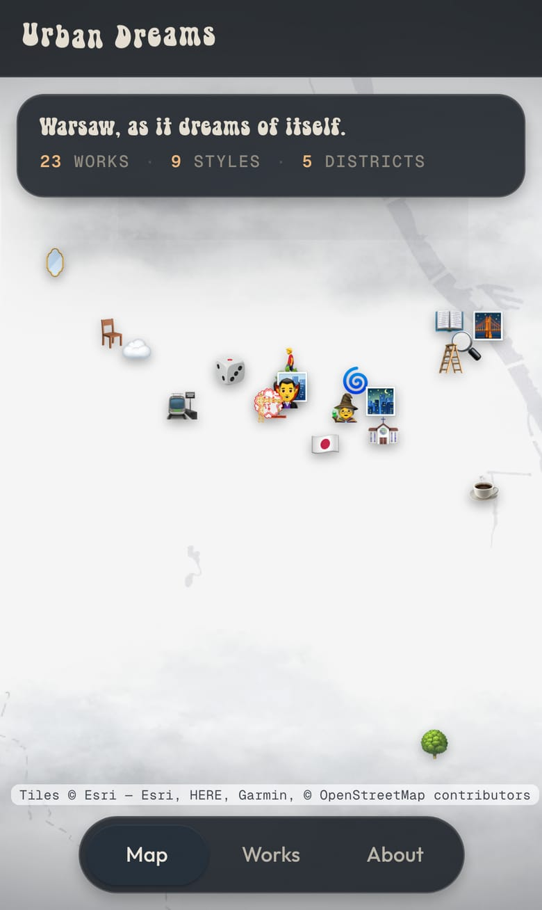
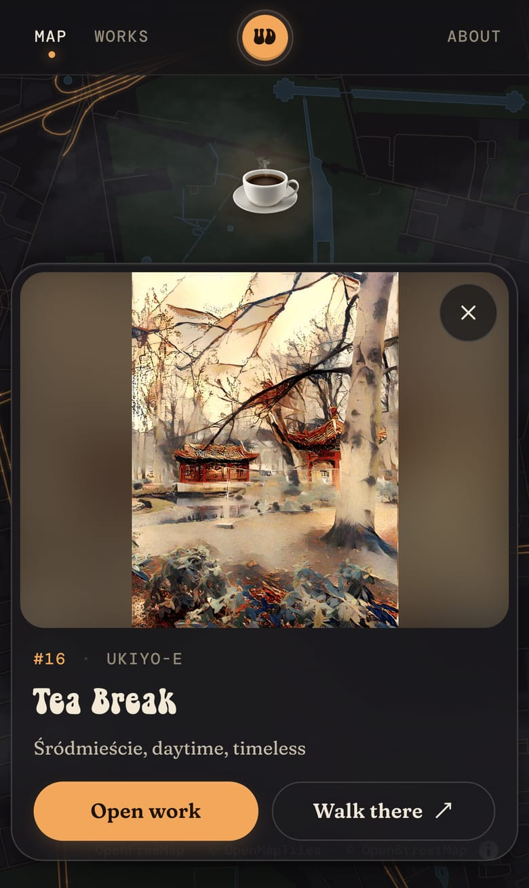
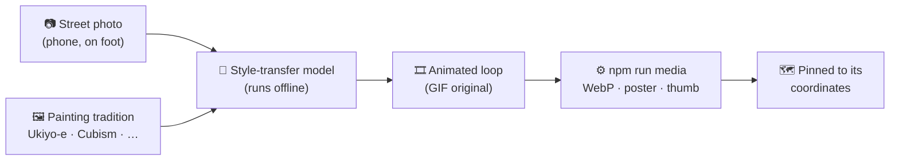
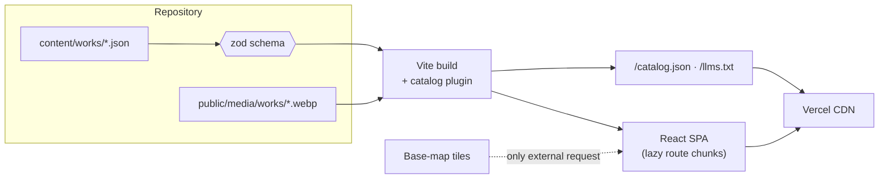

<h1 align="center">Urban Dreams</h1>

<p align="center"><b>Warsaw, as it dreams of itself.</b></p>

<p align="center">
Street photographs of Warsaw, re-painted by a neural style-transfer model in the language of
Ukiyo-e, Cubism, Symbolism, Vaporwave and more, then pinned back to the exact spot they were taken.<br/>
An AI art map you can actually walk.
</p>

<p align="center">
  <a href="https://github.com/Yegor-M/urban-dreams-web-app/actions/workflows/ci.yml"></a>
  
  
  
  
</p>

<p align="center">
  
</p>

<p align="center">
  
  
  
</p>

## The idea

Most AI art lives in a feed and dies in a scroll. Urban Dreams anchors it to the physical world: every image
is a real corner of Warsaw, so the artwork has a *place*. You open the map, find a pin, and walk there to stand
where the photo was taken and compare the street with its dream.

- **23 works · 9 painting styles · 5 districts**, from a Symbolist tree in Służew to a Ukiyo-e tea pavilion in Śródmieście.
- **Map-first.** Drifting clouds over a quiet base map, emoji pins that breathe, a preview that never crops the art.
- **Walkable.** Every work has one-tap walking directions in Google or Apple Maps.
- **Shareable.** Every view is a URL: `/?work=tea-break`, `/works?style=Ukiyo-e`, `/works/acid-tree`.
- **Open data.** The whole collection is published as [`/catalog.json`](#machine-readable) and [`/llms.txt`](#machine-readable).

## How the images are made



The model runs on the artist's machine. The site ships only the finished works: nothing is generated in the
browser and nothing is uploaded.

## Architecture

A static site with no backend and no runtime data fetching. The content lives in this repo as typed JSON.



| Layer | Where | Notes |
|---|---|---|
| Content | [`content/`](content) | One JSON per work. [`schema.ts`](src/content/schema.ts) is the contract: sequential ids, kebab-case slugs, coordinates inside Warsaw. Invalid content fails the build. |
| Media | [`scripts/sync-media.ts`](scripts/sync-media.ts) | ~250 MB of GIF originals become **28 MB** of animated WebP + posters + thumbs. Originals are cached locally and fetched from IPFS only when missing. |
| Map | [`src/components/map/`](src/components/map) | MapLibre with a custom "Night Warsaw" vector style: streets glow in sodium orange, the Vistula is a dark ribbon. Pins are real buttons; a canvas night-mist layer drifts over the city. |
| Design | [`docs/design-system.md`](docs/design-system.md) | Night surfaces, one warm "lantern" accent, display + body + mono type roles, matte "prints", shared-element transitions. Tokens in [`tokens.css`](src/styles/tokens.css). |
| Pages | [`src/pages/`](src/pages) | Map, Works (filterable gallery), Work (detail + walking directions), About, 404. Each is its own lazy chunk; MapLibre only loads on the map. |
| Machine-readable | [`scripts/catalog-plugin.ts`](scripts/catalog-plugin.ts) | Emits `/catalog.json` (full structured data) and `/llms.txt` at build time. |

**Budget.** Initial JS is ~99 kB gzip (React + router). The map route adds MapLibre: ~289 kB gzip on the main thread plus a ~154 kB worker, loaded only when you open the map. Gallery, work and about pages never load it. The gallery loads 40–80 kB
still posters; an animated original (0.5–3 MB) streams only when you open a work, or hover/focus its card.
Media URLs carry a version (`?v=…`) so they can be cached as immutable.

## Quick start

Requires Node ≥ 22.18 (see [`.nvmrc`](.nvmrc)). No accounts, keys or `.env` needed.

```bash
npm install
npm run dev          # http://localhost:5173
```

| Command | What it does |
|---|---|
| `npm run dev` | Vite dev server with HMR |
| `npm run check` | typecheck → lint → unit tests → production build (what CI runs) |
| `npm run test:e2e` | Builds, serves on :4173, runs Playwright on desktop + mobile Chrome |
| `npm run media` | Rebuilds optimised media from originals (incremental; `--force`, `--only <slug>`) |
| `npm run screenshots` | Re-captures `docs/screenshots/` from a running preview |

## Deploy to Vercel

Import the repo in Vercel. [`vercel.json`](vercel.json) already sets the framework, the SPA fallback and
cache headers (`/assets` and versioned `/media` immutable). No environment variables are required.

```bash
npx vercel        # preview
npx vercel --prod # production
```

## Configuration

All optional. The base map is a custom "Violet Dusk" style ([`mapStyles.ts`](src/components/map/mapStyles.ts))
over [OpenFreeMap](https://openfreemap.org) vector tiles: free, keyless, no account.

| Variable | Default | Purpose |
|---|---|---|
| `SITE_URL` | `VERCEL_PROJECT_PRODUCTION_URL` | Makes URLs in `/catalog.json` and `/llms.txt` absolute |

## Machine-readable

The collection is built to be read by people *and* agents:

- **`/catalog.json`**: every work with title, description, style, mood, coordinates, image URLs and dimensions.
- **`/llms.txt`**: a plain-text summary of the project and each work, following the [llms.txt](https://llmstxt.org) convention.
- **[`AGENTS.md`](AGENTS.md)**: how coding agents should work in this repo: commands, invariants, recipes.

## Tests

- **Unit** ([`tests/unit`](tests/unit)): the content contract. Schema, sequential ids, file naming, Warsaw bounds,
  media present for every work, per-file size budget.
- **E2E** ([`tests/e2e`](tests/e2e)), run on desktop and mobile viewports:
  - every pin renders, and a preview opens and closes;
  - deep links work;
  - the gallery filters;
  - work pages navigate;
  - unknown routes show the 404 page;
  - no horizontal overflow at 320px, and every touch target on a phone is at least 44px;
  - **with every third-party host blocked**, all content still renders and only base-map tiles go missing.

## Evolution

Urban Dreams started in 2025 as a **Telegram Mini App with a TON NFT collection**. Each work was minted on-chain,
its metadata and images pinned on IPFS, with a treasury page and wallet login. The art was the interesting part;
the wrapper was not. Nobody needed a token to enjoy a picture of their street, and the stack was fragile:

- public IPFS gateways started rate-limiting, so the map loaded nothing;
- the free base-map provider began requiring an API key;
- the app wouldn't render outside Telegram at all.

v2 keeps the art and drops the wrapper. It's a web-first, offline-safe static site. The originals were recovered
from IPFS once and turned into versioned, optimised media, and every chain, wallet and Telegram dependency is
gone. The history lives in git (`master` before `web-relaunch`).

## License

Code: [MIT](LICENSE). Artworks and texts: © Yegor-M, all rights reserved. The *Retro Cookies* typeface is © 7NTypes,
used under its own license.
