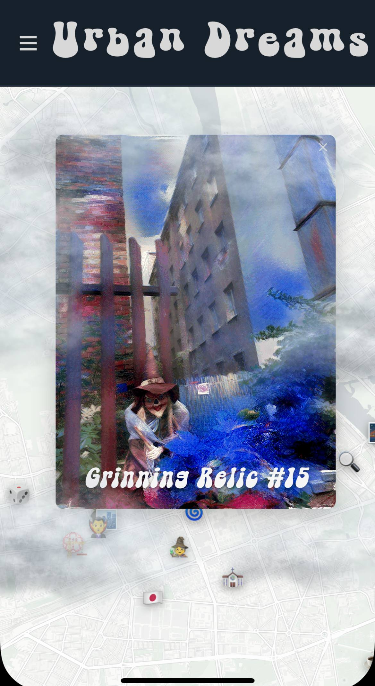
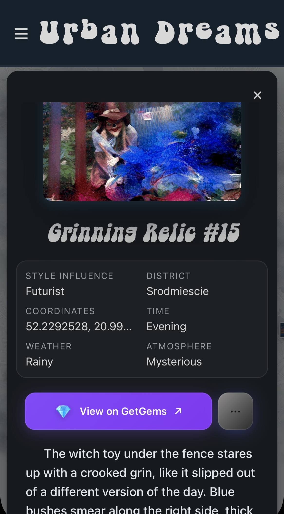
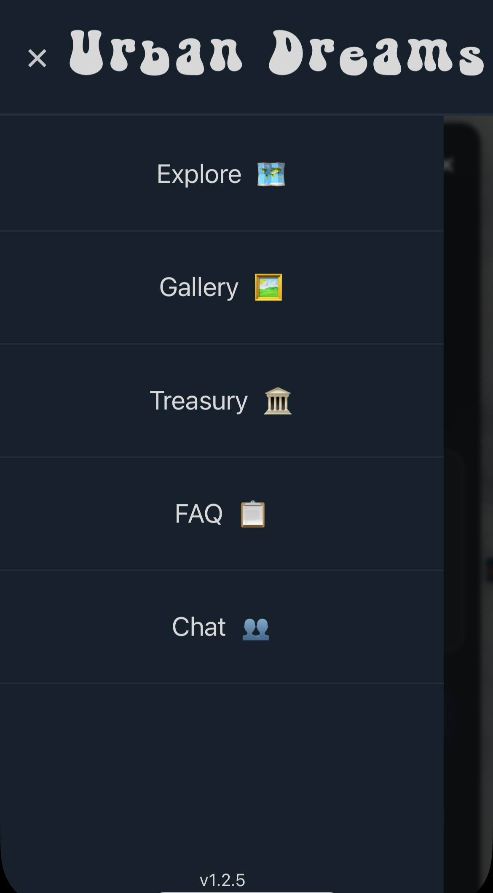
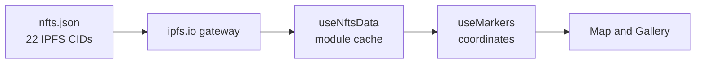

<h1 align="center">Urban Dreams Web App</h1>

<p align="center"><b>A Telegram Mini App that puts a TON NFT collection on a map of Warsaw.</b></p>

<p align="center">
Each NFT in <i>Urban Dreams: Warsaw Edition</i> is tied to a real place in Warsaw. The app reads metadata from IPFS,
places every item on a Leaflet map, and adds a gallery, a treasury balance view and TON Connect wallet login,
all inside <a href="https://t.me/UrbanDreamsBot/Explorer">Telegram</a>.
</p>

<p align="center">
  <a href="https://github.com/Yegor-M/urban-dreams-web-app/actions/workflows/github-pages-deploy.yml"></a>
  <a href="LICENSE"></a>
</p>
<p align="center">
  
  
  
  
  
  
</p>

<p align="center">
  <a href="#quick-start">Quick start</a> ·
  <a href="#architecture-and-data-flow">Architecture</a> ·
  <a href="#core-engineering-highlights">Highlights</a> ·
  <a href="#local-development">Development</a> ·
  <a href="#configuration">Configuration</a> ·
  <a href="#limits">Limits</a> ·
  <a href="#license">License</a>
</p>

<p align="center">
  
  
  
</p>

## Quick start

The fastest way to see the app is the live bot: [t.me/UrbanDreamsBot/Explorer](https://t.me/UrbanDreamsBot/Explorer).

To run it locally (Node 18+, Yarn 1):

```bash
echo "127.0.0.1 tma.internal" | sudo tee -a /etc/hosts   # the dev server binds to tma.internal
yarn install
yarn dev                                                 # serves https://tma.internal:5173
```

The dev server always uses HTTPS (a self-signed certificate from `@vitejs/plugin-basic-ssl`, or `tma.internal.pem` /
`tma.internal-key.pem` from the repo root if both exist). Open the URL from a Telegram bot's Mini App settings or in
Telegram Desktop. The browser mock in [src/mockEnv.ts](src/mockEnv.ts) is disabled (its import is commented out in
[src/index.tsx](src/index.tsx)), so a plain browser tab has no launch parameters and won't render the app.

No accounts, API keys or `.env` file are needed: every network call goes to a public endpoint.

## Architecture and data flow



| Stage | Code | What it does |
|---|---|---|
| Boot | [src/index.tsx](src/index.tsx), [src/init.ts](src/init.ts) | Starts the Telegram SDK, resolves the nickname and the `debug` / `eruda` / `mock` flags from launch params or the query string, mounts the Mini App and binds theme CSS variables. |
| Shell | [src/components/Root.tsx](src/components/Root.tsx), [src/components/App.tsx](src/components/App.tsx) | Wraps the app in an error boundary and `TonConnectUIProvider`, picks the iOS or base UI from the platform, and routes with `HashRouter`. |
| Item list | [src/data/nfts.json](src/data/nfts.json) | Static list of items: index, metadata CID and on-chain item address. |
| Metadata | [src/hooks/useNftsData.ts](src/hooks/useNftsData.ts), [src/utils/ipfs.ts](src/utils/ipfs.ts) | Fetches each item's JSON from `ipfs.io` in parallel and rewrites `ipfs://` image URLs to the gateway. |
| Markers | [src/hooks/useMarkers.ts](src/hooks/useMarkers.ts) | Reads the `Coordinates` / `Location` attribute and assigns an emoji per item. |
| Map | [src/components/LeafletMap.tsx](src/components/LeafletMap.tsx) | CartoDB tiles bounded to Warsaw, zoom-scaled emoji markers, a popup and a modal with attributes, plus GetGems, Google Maps, share and Tonscan actions. |
| Gallery | [src/pages/ItemsPage.tsx](src/pages/ItemsPage.tsx) | Grid of all items built from the same cached metadata. |
| Treasury | [src/pages/TreasuryPage.tsx](src/pages/TreasuryPage.tsx) | Reads the treasury wallet balance from toncenter `getAddressInformation` and shows it minus a 0.99 TON keep-alive reserve. |
| Content | [src/pages/VisionPage.tsx](src/pages/VisionPage.tsx), [src/pages/FaqPage.tsx](src/pages/FaqPage.tsx) | Static project concept and FAQ. |

Routes are defined in [src/navigation/routes.tsx](src/navigation/routes.tsx). The bottom navigation in
[src/components/UrbanLayout.tsx](src/components/UrbanLayout.tsx) links Explore (`/`), Gallery (`/items`),
Treasury (`/treasury`), FAQ (`/faq`) and the Telegram chat.

There is no backend: the app is a static bundle that talks to IPFS, toncenter and TON Connect directly.

## Core engineering highlights

**Network efficiency**
- **One metadata load per session.** `useNftsData` keeps a module-level result cache and shares a single in-flight promise, so the map and the gallery never fetch the same CIDs twice.
- **Cached treasury balance.** The toncenter response is stored in `localStorage` with a 24-hour TTL, and the request is cancelled with an `AbortController` when the page unmounts.

**Resilience**
- **Error boundary at the root.** [src/components/ErrorBoundary.tsx](src/components/ErrorBoundary.tsx) catches render errors and shows a reload button instead of a blank Mini App.
- **Init failure fallback.** If `init()` throws, [src/index.tsx](src/index.tsx) renders [src/components/EnvUnsupported.tsx](src/components/EnvUnsupported.tsx).
- **Missing data fallbacks.** Items without an image use `/404.png`, and items without coordinates are placed near the map center instead of being dropped.

**Map rendering**
- **Deterministic cloud layer.** The animated canvas overlay uses an xorshift PRNG with a fixed seed, so cloud positions are the same on every load and every resize.
- **Bounded viewport.** `maxBounds` with viscosity keeps the user inside Warsaw, and marker icons are resized on `zoomend`.

**Debuggability**
- **Runtime flags without a rebuild.** `debug:1`, `eruda:1` and `mock:1` in the bot's `start_param` (or `?debug=1&eruda=1&mock=1`) turn on SDK debug logging, the lazily loaded Eruda console, or a macOS theme / safe-area mock.

## Local development

```bash
yarn install
yarn dev          # Vite dev server, HTTPS, host tma.internal
yarn dev:https    # same, with HTTPS=true, which also enables vite-plugin-mkcert
yarn build        # production bundle in dist/
yarn preview      # serve dist/ on tma.internal
yarn lint         # ESLint over src/
yarn deploy       # build, then push dist/ to the gh-pages branch
```

To use your own trusted certificate instead of the self-signed one, generate it in the repo root (both files are gitignored):

```bash
mkcert -cert-file tma.internal.pem -key-file tma.internal-key.pem tma.internal
```

There is no test suite.

**CI.** [.github/workflows/github-pages-deploy.yml](.github/workflows/github-pages-deploy.yml) runs on every push to
`master`: Node 18, `yarn install --frozen-lockfile`, `yarn build`, then deploys `dist/` to GitHub Pages. It doesn't run
lint or type checks.

**Hosting.** The repo has three deploy paths: the Pages workflow, the `gh-pages` script and a linked Vercel project.
The TON Connect manifest ([public/tonconnect-manifest.json](public/tonconnect-manifest.json)) points at the Vercel URL.

## Configuration

There is no `.env.example`, and nothing needs to be set for the app to work.

| Variable | Where it's read | Required | Purpose |
|---|---|---|---|
| `TONAPI_KEY` | [src/pages/TreasuryPage.tsx](src/pages/TreasuryPage.tsx) | No | Meant to be a toncenter API key. **Currently never applied:** Vite only exposes `VITE_`-prefixed variables, so it compiles to `undefined` and requests go out unauthenticated. |
| `HTTPS` | [vite.config.ts](vite.config.ts) | No | **Shell variable, not read from `.env`.** Set by `yarn dev:https` through `cross-env` to enable `vite-plugin-mkcert`. |

Runtime flags come from the Telegram `start_param` or the query string, not the environment:

| Flag | Effect |
|---|---|
| `debug` | Calls the Telegram SDK's `setDebug(true)`. |
| `eruda` | Loads the Eruda mobile console. |
| `mock` | Mocks Telegram theme and safe-area events (for the macOS client). |
| `nick:<name>` / `?nickname=` | Nickname fallback when Telegram provides no user. |

The on-chain addresses and endpoints are hard-coded:

| Value | Location |
|---|---|
| Collection address | [src/constants/collection.ts](src/constants/collection.ts) |
| Treasury address, toncenter endpoint | [src/pages/TreasuryPage.tsx](src/pages/TreasuryPage.tsx) |
| IPFS gateway (`ipfs.io`) | [src/utils/ipfs.ts](src/utils/ipfs.ts), [src/hooks/useNftsData.ts](src/hooks/useNftsData.ts) |
| Item list | [src/data/nfts.json](src/data/nfts.json) |

## Limits

- **All-or-nothing metadata.** Items load through `Promise.all` with no retries, so one failed or slow IPFS request (19 s timeout) fails the whole map and gallery. A failed load also leaves the cached in-flight promise set, so the next mount gets the same rejection.
- **Single gateway.** Every item and image depends on `ipfs.io`.
- **Only runs inside Telegram.** The browser mock is disabled.
- **Treasury is read-only.** It shows the balance only. Epoch claims are described in the FAQ and Vision pages but not implemented in the UI.
- **Undeclared dependency.** [src/utils/ipfs.ts](src/utils/ipfs.ts) imports `axios`, which isn't in [package.json](package.json) and only resolves as a transitive dependency.
- **Large bundle.** The production build is a single ~860 kB JS chunk (~270 kB gzip).
- **Tooling debt.** `yarn lint` currently crashes on a typed-rule configuration error, and `tsc --noEmit` reports type errors. The build passes because Vite doesn't type-check.
- **Leftovers.** Template routes (`/theme-params`, `/launch-params`, `/ton-connect`), the unused contract wrapper in [src/wrappers/](src/wrappers/) and several unused dependencies (MapLibre, Mapbox, three, socket.io, Framer Motion, Emotion) are still in the tree.

## License

[MIT](LICENSE). The license file still carries the copyright line of the Telegram Mini Apps React template this project started from.
