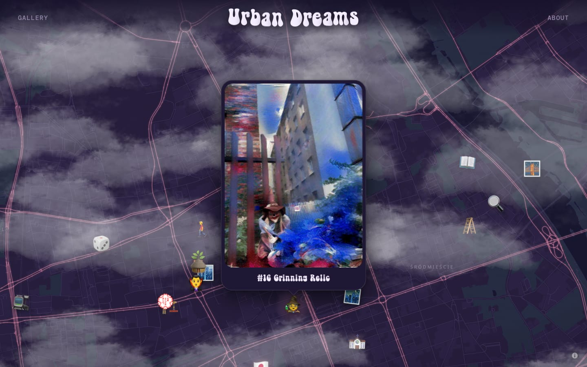
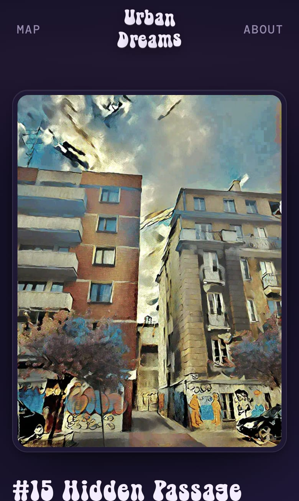
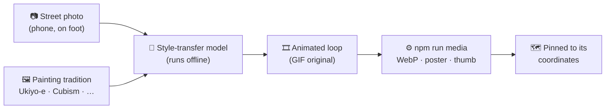
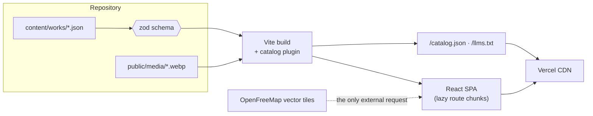

<h1 align="center">Urban Dreams</h1>

<p align="center"><b>Warsaw, as it dreams of itself.</b></p>

<p align="center">
Street photographs of Warsaw, re-painted by a neural style-transfer model in the language of
Ukiyo-e, Cubism, Symbolism, Vaporwave and more, then pinned back to the exact spot they were taken.<br/>
An AI art map you can actually walk.
</p>

<p align="center">
  <a href="https://ub-red.vercel.app"><b>ub-red.vercel.app</b></a>
</p>

<p align="center">
  <a href="https://github.com/yehomak/UrbanDreams/actions/workflows/ci.yml"></a>
  
  
  
  
  
  
</p>

<p align="center">
  
</p>

<p align="center">
  
  
  
</p>

## The idea

Most AI art lives in a feed and dies in a scroll. Urban Dreams anchors it to the physical world: every image is
a real corner of Warsaw, so the artwork has a *place*. You drift over the city at dusk, open a pin, and walk
there to stand where the photo was taken and compare the street with its dream.

- **23 works · 9 painting styles · 5 districts**, from a Symbolist tree in Służew to a Ukiyo-e tea pavilion in Śródmieście.
- **A map that dreams.** A dusk-violet city with pink-neon streets, white clouds that drift over it and move with
  it as you pan and zoom, and emoji pins that grow as you zoom in.
- **Unfolds from the pin.** Choosing a work glides the camera to its pin, and the card opens out of the pin's
  centre: the artwork and its title, and nothing else. Close it and it folds back in.
- **Walkable.** Every work has one-tap walking directions, and a link to the spot itself, in Google Maps.
- **Shareable.** Every view is a URL: `/?work=tea-break`, `/works?style=Ukiyo-e`, `/works/acid-tree`.
- **Open data.** The whole collection is published as [`/catalog.json`](https://ub-red.vercel.app/catalog.json)
  and [`/llms.txt`](https://ub-red.vercel.app/llms.txt).

## How the images are made



The model runs on the artist's machine. The site ships only the finished works: nothing is generated in the
browser and nothing is uploaded.

## Architecture

A static site with no backend and no runtime data fetching. The content lives in this repo as typed JSON; the
only third-party requests are the base-map tiles.



| Layer | Where | What it does |
|---|---|---|
| Content | [`content/`](content) | One JSON per work. [`schema.ts`](src/content/schema.ts) is the contract: sequential ids, kebab-case slugs, coordinates inside the map frame. Invalid content fails the build. |
| Media | [`scripts/sync-media.ts`](scripts/sync-media.ts), [`scripts/cloud-sprites.ts`](scripts/cloud-sprites.ts) | ~250 MB of GIF originals (recovered from IPFS, cached locally) become **28 MB** of animated WebP, posters and thumbs. The clouds are three sprites built from the original cloud. |
| Map | [`src/components/map/`](src/components/map) | MapLibre with a custom **Violet Dusk** style ([`mapStyles.ts`](src/components/map/mapStyles.ts)) over keyless [OpenFreeMap](https://openfreemap.org) tiles. Pins are real buttons that scale with zoom. The camera and the anchored preview share one geometry ([`previewLayout.ts`](src/components/map/previewLayout.ts)). |
| Sky | [`src/components/Sky.tsx`](src/components/Sky.tsx) | One canvas of 45 white clouds over the city, evenly spaced and **anchored to the map** ([`skyCamera.ts`](src/lib/skyCamera.ts)): they pan with the ground and spread with zoom. |
| Loading | [`src/components/curtain/`](src/components/curtain) | The original white running rabbit on a dusk backdrop, shown only while something is actually loading (`useCurtainHold`). |
| Pages | [`src/pages/`](src/pages) | Map, Gallery (filterable), Work (detail and walking directions), About, 404. Each is its own lazy chunk; MapLibre only loads on the map. |
| Design | [`docs/design-system.md`](docs/design-system.md) | Palette taken from the map (violet ink, lavender paper, neon pink, peach), one type family per role (Retro Cookies, Fraunces, DM Mono), motion rules. Tokens in [`tokens.css`](src/styles/tokens.css). |
| Machine-readable | [`scripts/catalog-plugin.ts`](scripts/catalog-plugin.ts) | Emits `/catalog.json` (full structured data) and `/llms.txt` at build time. |

**Budget.** Initial JS is about 99 kB gzip (React + router). The map route adds MapLibre (about 289 kB gzip plus a
154 kB worker), loaded only when you open the map. The gallery loads 40–80 kB still posters; an animated original
(0.5–3 MB) streams only when you open a work or hover its card. Media URLs carry a version (`?v=…`) and are
cached as immutable.

## Quick start

Requires Node ≥ 22.18 (see [`.nvmrc`](.nvmrc)). No accounts, keys or `.env` needed.

```bash
npm install
npm run dev          # http://localhost:5173
```

| Command | What it does |
|---|---|
| `npm run dev` | Vite dev server with HMR |
| `npm run check` | typecheck → lint → unit tests → production build (what CI runs) |
| `npm run test:e2e` | Builds, serves on :4173, runs Playwright on desktop + mobile Chrome |
| `npm run media` | Rebuilds optimised media from the originals (incremental; `--force`, `--only <slug>`) |
| `node scripts/cloud-sprites.ts` | Rebuilds the cloud sprites from `media-src/base_cloud.png` |
| `npm run screenshots` | Re-captures `docs/screenshots/` from a running site (`node scripts/screenshots.ts <url>`) |

## Deploy

The repo is connected to Vercel. [`vercel.json`](vercel.json) sets the framework, the SPA fallback and the cache
headers (`/assets` and versioned `/media` immutable). No environment variables are required; `SITE_URL`
(defaults to `VERCEL_PROJECT_PRODUCTION_URL`) only makes the URLs in `/catalog.json` and `/llms.txt` absolute.

```bash
vercel        # preview
vercel --prod # production
```

## For agents

The collection is built to be read by people *and* machines:

- **`/catalog.json`**: every work with title, description, style, mood, coordinates, image URLs and dimensions.
- **`/llms.txt`**: a plain-text summary of the project and each work, following the [llms.txt](https://llmstxt.org) convention.
- **[`AGENTS.md`](AGENTS.md)**: how coding agents should work in this repo: commands, invariants, recipes.

## Tests

- **Unit** ([`tests/unit`](tests/unit)): the content contract. Schema, sequential ids, file naming, map bounds,
  media present for every work, per-file size budget.
- **E2E** ([`tests/e2e`](tests/e2e)), on desktop and phone viewports:
  - every pin renders and is keyboard-accessible;
  - a preview opens above its pin, never covering it, and closes with focus back on the pin;
  - deep links, gallery filters, the Map ⇄ Gallery switch and work-page navigation work;
  - unknown routes show the 404 page;
  - no horizontal overflow at 320px, and every touch target on a phone is at least 44px;
  - **with every third-party host blocked**, all content still renders and only the base map goes missing.

CI ([`.github/workflows/ci.yml`](.github/workflows/ci.yml)) runs all of it on every push and pull request.

## Evolution

Urban Dreams started in 2025 as a **Telegram Mini App with a TON NFT collection**. Each work was minted on-chain,
its metadata and images pinned on IPFS, with a treasury page and wallet login. The art was the interesting part;
the wrapper was not. Nobody needed a token to enjoy a picture of their street, and the stack was fragile:

- public IPFS gateways started rate-limiting, so the map loaded nothing;
- the free base-map provider began requiring an API key;
- the app wouldn't render outside Telegram at all.

v2 ([#1](https://github.com/yehomak/UrbanDreams/pull/1)) keeps the art and drops the wrapper. It's a web-first,
offline-safe static site. The originals were recovered from IPFS once and turned into versioned, optimised media,
and every chain, wallet and Telegram dependency is gone. The Telegram/TON version lives on in git history
(`bfc06db` and earlier).

## License

Code: [MIT](LICENSE). Artworks and texts: © Yegor-M, all rights reserved. The *Retro Cookies* typeface is
© 7NTypes, used under its own license.
